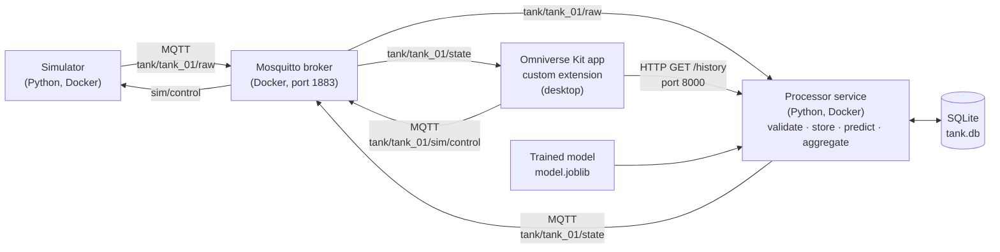

# Water Tank & Pump Digital Twin — System Plan

**Project:** Digital Twin Project 2, Topic 3 (Water tank and pump monitoring)
**Type:** Simulation-driven digital twin prototype
**Team:** _Member A (name, ID)_ · _Member B (name, ID)_
**Version:** 0.1 (planning) · Last updated: _date_

---

## 1. Problem statement

Small water storage tanks (e.g. a building rooftop tank fed by a pump) can overflow when inflow is abnormally high or a pump control fails, and can run dry when demand exceeds supply. Operators usually only see the current level, so they react after a problem has started.

This project builds a digital twin of one tank and pump that shows the live state in 3D, stores its history, and uses a machine learning model to **predict the water level 30 seconds ahead**, so overflow and low-level risks are flagged before they happen.

## 2. Intended user and expected benefit

| Item | Description |
|---|---|
| Intended user | Facility operator / maintenance technician responsible for a water storage tank |
| Main questions answered | What is the level now? Is the pump running? Where will the level be in 30 s? Is anything abnormal? What happened in the past hour? |
| Expected benefit | Earlier warning of overflow or low level than a current-level alarm alone; a stored history for fault investigation |

## 3. Asset boundary

**Inside the twin:**
- One cylindrical tank (`tank_01`)
- One inlet pipe with a pump (pump drives the inflow)
- One outlet pipe (consumer demand drives the outflow)
- Level sensor, inlet flow sensor, outlet flow sensor, pump on/off status

**Outside the twin (not modelled):**
- Upstream water supply, downstream consumers, pipe network hydraulics, water quality, electrical details of the pump

### Physical parameters (simulated)

| Parameter | Value | Note |
|---|---|---|
| Tank shape | Vertical cylinder | Constant cross-section, so volume is proportional to level |
| Capacity | 50 L | Small enough that changes are visible within minutes during a demo |
| Height | 0.80 m | |
| Inner diameter | 0.28 m | π × 0.14² × 0.80 ≈ 0.049 m³ ≈ 50 L |
| Pump nominal inflow | 8 L/min | When `pump_on = true` |
| Outflow (demand) | 0–10 L/min | Varies over time |

**Level equation (per 1 s step):**

```
level_pct(t+1) = level_pct(t) + (inflow_lpm − outflow_lpm) / 60 / capacity_L × 100 + noise
```

With a 50 L tank, a net flow of +6 L/min raises the level by 0.2 % per second (about 6 % in 30 s).

## 4. Architecture



**Design decisions**
- **MQTT** is the single protocol for all live streaming, chosen because it is lightweight, publish/subscribe, and supports "last will" messages for detecting disconnection.
- The **processor** is the only component that writes to the database and runs the AI model. The Omniverse extension only displays results, which keeps heavy work off the UI.
- A small **read-only HTTP endpoint** on the processor serves stored history, so other modules (the extension, plotting scripts) can retrieve data after a restart.
- The Omniverse extension runs its MQTT client in a **background thread** and applies scene changes only in Kit's **update event**, as required by the brief.
- Broker, simulator and processor are **containerized** with Docker Compose. The Kit application runs natively on the Ubuntu desktop.

## 5. State dictionary

### 5.1 Raw state message (simulator → processor)

| Field | Type | Unit | Valid range | Description |
|---|---|---|---|---|
| `asset_id` | string | – | `"tank_01"` | Asset identifier |
| `timestamp` | string | ISO 8601, UTC (`Z`) | Not in the future, not older than 60 s | Time of measurement |
| `seq` | integer | – | ≥ 0, increasing | Message counter, used to detect gaps |
| `level_pct` | float | % of tank height | 0.0 – 100.0 | Water level |
| `inflow_lpm` | float | L/min | 0.0 – 25.0 | Measured inlet flow |
| `outflow_lpm` | float | L/min | 0.0 – 25.0 | Measured outlet flow |
| `pump_on` | boolean | – | true / false | Pump running status |

Example:

```json
{"asset_id": "tank_01", "timestamp": "2026-10-23T03:50:00Z", "seq": 1042,
 "level_pct": 62.0, "inflow_lpm": 8.1, "outflow_lpm": 4.0, "pump_on": true}
```

### 5.2 Processed state message (processor → Omniverse)

Includes all raw fields plus:

| Field | Type | Unit | Description |
|---|---|---|---|
| `pred_level_30s_pct` | float or null | % | AI-predicted level 30 s ahead; null if the model cannot run |
| `model_status` | string | – | `OK`, `WARMING_UP` (less than 5 s of continuous history), `MODEL_MISSING` (no trained model yet), `MODEL_ERROR` (model failed to load or run), `INPUT_INVALID` (a feature is not a finite number) |
| `model_version` | string or null | – | Version of the model that made the prediction |
| `rule_alarm` | string | – | Threshold baseline on current level: `NONE`, `HIGH_LEVEL` (on ≥ 95 %, clears < 93 %), `LOW_LEVEL` (on ≤ 10 %, clears > 12 %) |
| `ai_alarm` | string | – | Based on prediction: `NONE`, `OVERFLOW_RISK` (on ≥ 90 %, clears < 88 %), `LOW_LEVEL_RISK` (on ≤ 15 %, clears > 17 %) |
| `level_mean_60s_pct` | float | % | Rolling 60 s mean level |
| `level_max_10min_pct` | float | % | Maximum level over the last 10 min |
| `level_min_10min_pct` | float | % | Minimum level over the last 10 min |
| `net_flow_lpm` | float | L/min | `inflow_lpm − outflow_lpm` |
| `alarms_last_hour` | integer | count | Number of alarm onsets (rule + AI) in the last 60 min |
| `pumped_volume_l_last_hour` | float | L | Water delivered by the inlet in the last 60 min |
| `pipeline_delay_ms` | float | ms | `processed_at − timestamp` (measurement to processed) |
| `processed_at` | string | ISO 8601, UTC | Time the processor finished this message |

Alarms use **hysteresis** (a separate clear threshold) so sensor noise near a threshold cannot make an alarm flicker on and off.

Invalid raw messages are never turned into a state message. They are stored in the `rejected` table and published on `tank/tank_01/rejected` with the reason. Duplicate and out-of-order messages (timestamp not newer than the last stored one) are also rejected.

### 5.3 Simulator control message (Omniverse → simulator)

| Field | Type | Valid values |
|---|---|---|
| `scenario` | string | `normal`, `fill`, `drain`, `abnormal_inflow`, `pump_failure` |
| `inject_invalid` | boolean | true sends one malformed message (for testing) |

### 5.4 Database (SQLite, `data/tank.db`)

| Table | Contents |
|---|---|
| `readings` | Every accepted message: raw values, `d_level_5s`, prediction, model status and version, both alarms, receive/process times and pipeline delay |
| `alarms` | One row per alarm episode: source (`rule`/`ai`), alarm name, start, end, level at start |
| `rejected` | Every rejected message: time, topic, payload (first 2000 characters), reason |

- WAL mode, so the HTTP API can read while the processor writes. Only the processor writes.
- On restart, the processor restores the last timestamp, recent level history and any open alarms from the database.
- An online backup (SQLite backup API) is written to `data/backups/` every 10 minutes; the newest 6 are kept.

## 6. Communication interfaces

| Interface | Protocol | Address | Direction | QoS / notes |
|---|---|---|---|---|
| Raw state | MQTT | `tank/tank_01/raw` | Simulator → processor | QoS 1 |
| Processed state | MQTT | `tank/tank_01/state` | Processor → extension | QoS 1 |
| Rejected messages | MQTT | `tank/tank_01/rejected` | Processor → (log/monitor) | Contains reason for rejection |
| Simulator status | MQTT | `tank/tank_01/status` | Simulator → all | `online` / `offline` (last will), retained |
| Processor status | MQTT | `tank/tank_01/processor/status` | Processor → all | `online` / `offline` (last will), retained |
| Simulator control | MQTT | `tank/tank_01/sim/control` | Extension → simulator | Scenario selection |
| History query | HTTP | `GET http://localhost:8000/history?minutes=N` | Extension → processor | Stored readings, oldest first (N ≤ 1440) |
| Aggregates query | HTTP | `GET http://localhost:8000/aggregates` | Any → processor | Aggregates at the latest reading |
| Alarm history | HTTP | `GET http://localhost:8000/alarms?hours=N` | Any → processor | Alarm episodes with start, end and duration |
| Rejected messages | HTTP | `GET http://localhost:8000/rejected?limit=N` | Any → processor | Latest rejected messages and reasons |
| Health | HTTP | `GET http://localhost:8000/health` | Any → processor | MQTT connection, counts, last reading age, model status |
| Broker | TCP | `localhost:1883` | – | Mosquitto |

## 7. Sampling rate and timing

| Item | Value | Justification |
|---|---|---|
| Sampling / publish rate | 1 Hz | Level changes by at most ~0.4 %/s at maximum net flow, so 1 Hz captures all meaningful changes; matches brief recommendation |
| Stale threshold | 5 s without a processed message | 5 missed samples; avoids false alarms from a single delayed message |
| Prediction horizon | 30 s (30 samples ahead) | Long enough for an operator to react, short enough to predict accurately |
| End-to-end delay target | ≤ 2 s | Measured as display time − `timestamp` |

## 8. AI task

| Item | Definition |
|---|---|
| Task | Regression: predict `level_pct` at t + 30 s |
| Inputs (features) | `level_pct`, `inflow_lpm`, `outflow_lpm`, `pump_on`, `net_flow_lpm`, `d_level_5s` (level change over last 5 s) |
| Not used as input | Scenario name or any simulator fault label |
| Models | Linear regression and random forest, compared |
| Baseline | Persistence: predicted level = current level |
| Metrics | MAE and RMSE in percentage points, model vs baseline |
| Data split | By simulation run (e.g. runs 1–15 train, 16–20 test); never random row split |
| Held-out evaluation | One operating setting not seen in training (e.g. a higher abnormal inflow rate) |
| Operational meaning | Predicted level ≥ 90 % → overflow risk warning; ≤ 15 % → low-level risk warning |
| Invalid / missing inputs | Model is not run; `model_status` set to `INPUT_INVALID` or `WARMING_UP`, and the UI shows "Prediction unavailable" instead of a stale number |

## 9. Visual mapping (state → Omniverse)

| Variable | Prim / UI element | Mapping |
|---|---|---|
| `level_pct` | `/World/Tank_01/Water` | Z-scale = `level_pct / 100`, bottom fixed to tank floor |
| `pump_on` | `/World/Tank_01/Pump` | Green material when on, grey when off |
| `inflow_lpm` | `/World/Tank_01/InletPipe` + UI | Pipe colour intensity + numeric value |
| `outflow_lpm` | `/World/Tank_01/OutletPipe` + UI | Pipe colour intensity + numeric value |
| `rule_alarm`, `ai_alarm` | `/World/Tank_01/WarningLight` + UI | Green = none, amber = AI risk, red = rule alarm |
| `pred_level_30s_pct` | UI panel + optional ghost marker on tank | Numeric value and dashed line at predicted height |
| Connection status | UI panel | `LIVE` / `STALE` / `DISCONNECTED` |
| History | UI trend plot | Level and predicted level over last N minutes |

## 10. Scenarios

| Scenario | Behaviour | Expected twin response |
|---|---|---|
| `normal` | Pump switches on below 30 %, off above 80 %; demand varies 2–6 L/min | Level cycles between ~30 % and ~80 %; no alarms |
| `fill` | Pump on, low demand | Level rises steadily |
| `drain` | Pump off, demand 4–8 L/min | Level falls steadily; low-level risk near the bottom |
| `abnormal_inflow` | Inflow rises to ~15 L/min and pump control does not switch off | AI overflow warning appears before the level reaches 95 % |
| `pump_failure` | Pump reports on but inflow drops to ~0 | Level falls unexpectedly; low-level risk warning |

## 11. Acceptance criteria

| ID | Criterion | How it is measured |
|---|---|---|
| AC1 | Updates arrive at 1 Hz ± 10 % | Count records in SQLite over 5 min |
| AC2 | Median data-to-display delay ≤ 1 s, maximum ≤ 2 s | Extension logs display time − `timestamp` |
| AC3 | Scene water height matches `level_pct` within 1 % | Compare prim scale with UI value |
| AC4 | Model MAE on test runs is at least 50 % lower than persistence baseline MAE | Evaluation script output |
| AC5 | In `abnormal_inflow`, AI warning appears ≥ 20 s before level reaches 95 % | Timestamps of warning vs threshold crossing in database |
| AC6 | UI shows `STALE` within 6 s of the simulator stopping and returns to `LIVE` within 3 s of restart | Stopwatch + logs |
| AC7 | 100 % of malformed or out-of-range test messages are rejected and logged with no crash | Integration test |
| AC8 | After restarting all services, the last 60 min of history can be retrieved and plotted | Restart test |

## 12. Assumptions and limitations

- The system is a **simulation**; the model is trained and tested on synthetic data and has not been validated against a physical tank.
- The tank is a perfect cylinder, so level is directly proportional to volume.
- Flows are measured without lag; noise is Gaussian (level σ = 0.3 %, flow σ = 0.1 L/min).
- Inflow comes only from the pump; there is no gravity feed or leakage unless injected.
- Only one asset is monitored; there is no authentication on the MQTT broker (local network only).
- SQLite is used for simplicity; it is suitable for one writer at 1 Hz but not for large multi-asset deployments.

## 13. Connecting to a physical asset (future work)

To replace the simulator with a real tank:
- **Level:** ultrasonic or pressure level sensor, converted to %.
- **Flow:** pulse-output flow meters on the inlet and outlet pipes.
- **Pump status:** relay or current sensor on the pump supply.
- **Adapter:** a microcontroller or Raspberry Pi (e.g. ESP32 or Pi with Python) reads the sensors and publishes the **same JSON schema** to `tank/tank_01/raw` at 1 Hz. No other component needs to change.
- **Before trusting predictions:** collect real data, retrain the model, and validate against measured levels; add MQTT authentication and TLS.

## 14. Development environment (fill in)

| Item | Value | How to find it |
|---|---|---|
| Operating system | | `lsb_release -d` |
| GPU | | `nvidia-smi --query-gpu=name --format=csv,noheader` |
| NVIDIA driver | | `nvidia-smi --query-gpu=driver_version --format=csv,noheader` |
| Kit App Template commit | | `git -C ~/kit-app-template rev-parse HEAD` |
| Kit SDK version | | Shown in the app title bar / launch log |
| Python (services) | | `python3 --version` |
| Docker | | `docker --version` |
| Mosquitto | | Image tag in `docker-compose.yml` |
